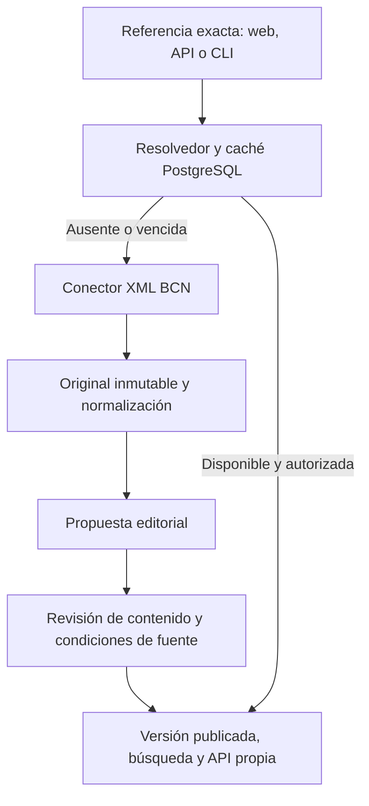

# Conectores y consulta bajo demanda

## Alcance actual

Legisdata descubre metadatos selectivos y, al consultar una referencia concreta, valida la respuesta XML, conserva evidencia y propone una representación editorial. La lectura pública sólo muestra versiones publicadas de fuentes habilitadas. El primer hito se conserva; el [segundo hito](bcn-segundo-hito.md) incorpora SPARQL, reservas breves y demanda editorial. No se sincroniza automáticamente el corpus ni se promete una búsqueda remota exhaustiva.

## Capacidades y evidencia

| Servicio | Evidencia y alcance | Estado en Legisdata |
| --- | --- | --- |
| Texto XML BCN | [Documento técnico oficial](https://www.leychile.cl/esquemas/accesoLeyesChilenas4.pdf), endpoint `Consulta/obtxml?opt=7&idNorma=...` o `idLey=...` | Implementado para referencia exacta; pruebas sintéticas y captura real de Ley 19.880 el 27-09-2026. También hubo HTTP 401 previos: disponibilidad no garantizada. |
| JSON de LeyChile | `get_norma_json`, utilizado por el prototipo existente | Experimental. Extracción de artículos reconocibles, metadatos explícitos; no garantía del texto completo. |
| Metadatos BCN | [Consultas SPARQL](https://datos.bcn.cl/es/documentacion/consultas-sparql) | Adaptador selectivo implementado; piloto desactivado por defecto. |
| Relaciones | [Datos de normas BCN](https://datos.bcn.cl/es/documentacion/normas) | Candidatos para integración futura; comprobar cobertura, dirección y fecha. Las relaciones públicas actuales requieren validación. |
| Historial completo y detección de cambios | No hay contrato verificado que cubra todas las normas | No implementado. El historial local contiene versiones conservadas y publicadas, no todo el historial oficial. |
| Descubrimiento remoto por palabras | SPARQL por título y materias comprobadas; sin garantía de exhaustividad | Bloque independiente de FTS local; hasta diez candidatos, sin descarga de XML. |

La documentación técnica antigua no acredita disponibilidad actual, cuotas contractuales ni permiso comercial. El éxito de una consulta tampoco autoriza automáticamente redistribución. La política de BCN empieza bloqueada: un administrador debe registrar evidencia, alcance y fundamento en `/admin/fuentes`; cada lote mantiene su revisión propia. No se evade un bloqueo HTTP de la fuente.

## Persistencia y trazabilidad

- `document_identifiers` distingue identidad externa y norma interna; los números no son globalmente únicos.
- `source_documents` conserva URL, fuente, identidad, captura, checksum SHA-256, versión del parser, representación normalizada y referencia al original inmutable en `.storage`.
- `source_observations` registra capturas, revalidaciones, fallos y eventos métricos diferenciados por operación. No registra consultas libres, texto jurídico, correo ni IP. Los accesos a caché actualizan `last_accessed_at`.
- `source_cache` guarda referencia, representación, validadores HTTP, última comprobación, expiración y plazo de reintento. La clave incluye fuente, referencia y versión de parser.
- `source_budgets` conserva la espera compartida. `source_leases` coordina reservas por referencia y proveedor con propietario y vencimiento; HTTP, normalización y almacenamiento ocurren fuera de transacciones. El cliente XML no añade reintentos ocultos.
- Una modificación produce otra propuesta. Una respuesta 304 o el mismo contenido con el mismo parser no crea otra versión. Un parser nuevo conserva su propia representación.
- Fechas de captura, fecha de versión indicada por la fuente, vigencia jurídica y publicación editorial son conceptos distintos. Una fecha de vigencia ausente permanece nula; `no derogado` no se transforma automáticamente en `vigente`.
- Notas y favoritos referencian la versión consultada. Expirar o eliminar punteros de caché no debe eliminar esa versión ni su evidencia. Bloquear una fuente impide nuevas lecturas públicas, conservando los registros privados existentes.

La caché positiva dura seis horas; la ausencia confirmada, un minuto. Fallos de red y límites de fuente no se convierten en 404. Se respeta un periodo de espera compartido; cuando existe una publicación anterior, permanece disponible y se marca la comprobación desactualizada. Las respuestas jurídicas HTTP exigen revalidación para volver a comprobar publicación y política antes de servir contenido.

## Operación y límites conocidos

1. Aplicar migraciones, incluidas `0011_source_cache_and_provenance.sql` y `0012_discovery_leases_and_review_requests.sql`, e importar sólo el fixture de desarrollo si se necesita.
2. Configurar almacenamiento duradero compartido si hay varias instancias. El adaptador incluido es de filesystem; un disco efímero de despliegue no conserva evidencia.
3. Resolver desde `/consultar`, `/api/v1/resolver` o `source:bcn:resolve`.
4. Revisar original, metadatos, advertencias y diferencias en `/admin/importaciones/:batchId`; aprobar o rechazar. Habilitar uso de la fuente con evidencia antes de publicar.
5. Respaldar PostgreSQL y originales conjuntamente. `.staging`, `.storage`, secretos y resultados de pruebas quedan fuera de Git.

Es almacenamiento selectivo por consulta: cada documento consultado válido deja evidencia y propuesta. `source:cleanup` elimina datos temporales y métricas vencidas; su programación corresponde al operador. No hay refresco programado de documentos, descarga de adjuntos, reconciliación automática de capturas antiguas ni otro conector operativo. Los adjuntos referenciados requieren revisión; el parser rechaza estructuras que podrían perder contenido silenciosamente.

El resolvedor utiliza dos transacciones breves y una reserva de 30 segundos. El timeout XML sigue siendo 15 segundos. Un propietario vencido o reemplazado no puede persistir una respuesta tardía. La espera y revalidación se hacen con peticiones independientes, sin trabajadores permanentes. El límite HTTP por cliente sigue siendo local al proceso. Las solicitudes GET de resolución pueden crear propuestas, por lo que los enlaces no hacen prefetch.

## Próximos hitos

1. Confirmar disponibilidad de XML desde el entorno de despliegue y condiciones aplicables; añadir muestras oficiales autorizadas a pruebas de contrato sin incorporar secretos o capturas de staging a Git.
2. Programar la limpieza de temporales y definir revisión de propuestas abandonadas antes de considerar el borrado de originales. No habilitar borrado general del corpus.
3. Migración controlada de identidades de capturas históricas existentes antes de habilitar el conector sobre una base de producción. No fusionar documentos sólo por número.
4. Ampliar la evidencia de cobertura y actualización de SPARQL. Las relaciones observadas siguen sin importarse como verificadas.
5. Conectores independientes para Diario Oficial (original por CVE, distinto de consolidación), CGR/DT/SII (dictámenes y doctrina administrativa) y PJUD/Tribunal Constitucional (resoluciones). Antes de implementar: contrato de acceso, condiciones, autenticación, cuotas, identificadores estables, fechas, redacciones/anónimos y mecanismo de actualización. La API estadística judicial no acredita una API de sentencias. El registro de Diario Oficial es sólo una reserva de capacidad, no un conector funcional.

El contrato actual de referencia está especializado en `idNorma`/`idLey`. Un segundo conector debe ampliar ese contrato con sus identificadores propios; no adaptar artificialmente un CVE o rol de causa a un ID BCN. Lo reutilizable es el flujo de evidencia, política, versiones y revisión.

## Verificación de este hito (27-09-2026)

- Migración y fixture en PostgreSQL 16 aislado; 105 pruebas unitarias/de integración aprobadas, incluidas concurrencia, 304, caché negativa, backoff, actualizaciones pendientes, bloqueo de lecturas públicas y auditoría administrativa.
- TypeScript, ESLint, validación del fixture y build de producción aprobados.
- Diez pruebas de navegación Chromium aprobadas sobre el build de producción con corpus de demostración; incluyen consulta exacta, estados de error y acceso anónimo denegado a administración. No equivalen a pruebas de proveedores OIDC reales.
- CLI real: `Ley 19.880` devolvió una captura HTTP 200, identificador `210676`, 92 nodos, fecha de versión declarada `2026-02-05` y estado `pending_review`. La consulta siguiente devolvió `cache: hit`; no se publicó la captura ni se habilitó la política BCN.
- El primer intento de E2E en desarrollo agotó tiempos de espera por compilación de rutas. CI utiliza `PLAYWRIGHT_USE_BUILD=1` después del build para comprobar la navegación sin esa compilación inicial.

## MVP: contrato de incorporación

Desde el MVP, GET del resolvedor es sólo consulta de estado; POST requiere cuenta y acción explícita. La lectura publicada sigue pública. El parser XML v3 conserva bloques y cobertura; la publicación automática exige autorización de texto completo e integridad comprobada. Véase [operación y evidencia del MVP](mvp-ingesta-publicacion.md), incluidas las condiciones pendientes de activación y la fecha futura declarada por la captura real del Código Civil.
